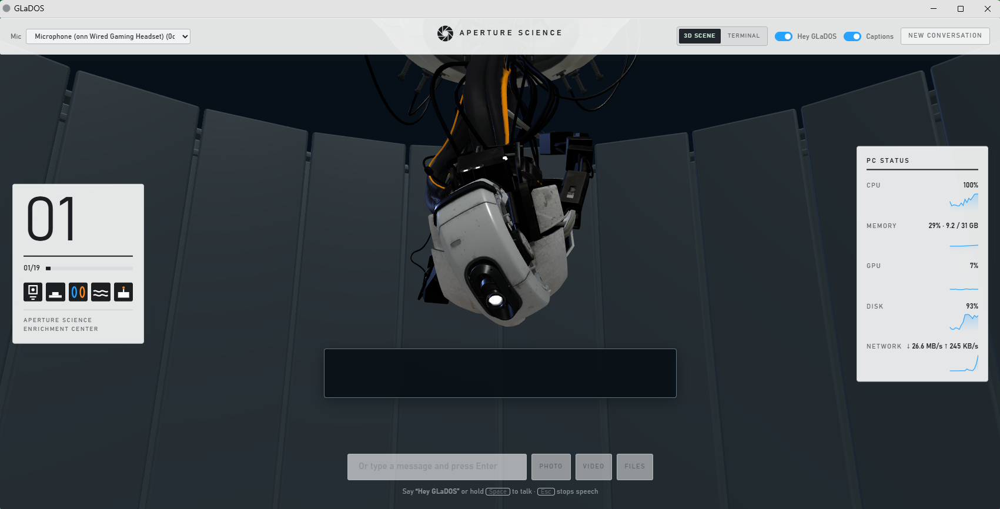

# GLaDOS: a multi-agent voice assistant for Windows

A personal voice assistant that runs locally on a Windows PC. You talk to it in the browser; it
answers out loud in character, and it can actually do things on the computer: open and focus apps,
click and type, take screenshots, browse, and edit files.

Behind the persona, one coordinator agent routes each request to the right model across two AI
providers (OpenAI GPT and Anthropic Claude) through an [OpenClaw](https://github.com/openclaw)
gateway, with cross-provider fallbacks and an optional local model.



## What it does

- **Voice in, voice out.** Speech-to-text with ElevenLabs. Replies stream to Fish Audio over a
  WebSocket and start playing while the model is still writing.
- **Multi-agent routing.** The GLaDOS coordinator judges each request's difficulty and hands it to
  one worker agent with a short, isolated brief. It doesn't broadcast the whole conversation.
- **Desktop control.** Custom PowerShell helpers use Windows UI Automation and Win32 input APIs
  to find and click real UI elements by name, type, focus windows and capture any monitor.
- **Confirmation before destructive actions.** Deleting, overwriting or uninstalling needs an
  explicit Confirm from the page. Everything else runs immediately.
- **3D interface.** A Three.js scene (as an OpenClaw control-UI plugin) with idle, listening and
  talking states.
- **Phone access** through Tailscale Serve, with no ports opened to the internet.

## Architecture

```
 Browser (index.html)  ──mic audio──▶  server.ps1 (localhost:8765)  ──▶ ElevenLabs STT
        ▲                                   │
        │ streamed audio                    │ chat (server-side token)
        │                                   ▼
 fish-proxy (localhost:18766) ◀─text─  OpenClaw gateway (127.0.0.1:18789)
        │                                   │
        ▼                                   ├─▶ GLaDOS coordinator
   Fish Audio TTS                           │      ├─▶ gpt-light / gpt-work / gpt-deep    (OpenAI)
                                            │      └─▶ claude-work / claude-deep          (Anthropic)
                                            └─▶ local fallback: Ollama qwen3:8b (optional)
```

### Agent routing

| Agent | Primary model | Fallbacks | Used for |
| --- | --- | --- | --- |
| glados | GPT-6 Luna | Claude Sonnet 5, local qwen3 | Conversation and coordination |
| gpt-light | Gemini Flash | Claude Sonnet 5, local | Small talk, summaries, quick lookups |
| gpt-work | GPT-6 Sol | Claude Sonnet 5, local | Implementation, debugging |
| gpt-deep | GPT-6 Astra | Claude Opus 5, local | Hard reasoning, review after a failed attempt |
| claude-work | Claude Sonnet 5 | GPT-6 Sol, local | Implementation, research, writing |
| claude-deep | Claude Opus 5 | GPT-6 Astra, local | Hard analysis, targeted review |

Each worker has an `-execute` twin used only after the user confirms a destructive step. At most
two workers run at once, and if one provider is rate-limited the coordinator switches to the other
instead of retrying. Agent instructions live in [`openclaw/workspaces/`](openclaw/workspaces), and
the full routing config is [`openclaw/openclaw.example.json`](openclaw/openclaw.example.json).

## Security decisions

- The gateway only listens on `127.0.0.1`. Its token stays server-side and never reaches the browser.
- Each server run generates a random page token, and every request must send it back and come from
  the same origin, so other websites can't drive the assistant.
- No API keys in the code. Keys come from environment variables (see [`.env.example`](.env.example)).
  Claude and GPT use their official CLI logins, and the launcher strips API-key variables so a
  paid API fallback can't kick in by accident.
- Agents are told never to read or print credential files.

## Project layout

| Path | What it is |
| --- | --- |
| `server.ps1`, `index.html` | Local web server and voice interface |
| `openclaw-bridge.ps1`, `poll-execute-reply.mjs` | Connects the server to the gateway; streams replies and live tool activity |
| `openclaw-env.ps1`, `openclaw-gateway.ps1`, `Start-GLaDOS-OpenClaw.ps1` | Environment setup and launchers |
| `fish-proxy/` | Node WebSocket proxy that streams text to Fish Audio and audio back to the page |
| `Find-UIElement.ps1`, `Send-Input.ps1`, `Focus-Window.ps1`, `Open-App.ps1`, `Capture-Monitor.ps1` | Windows desktop-control helpers |
| `openclaw/plugins/glados-3d-scene/` | 3D scene control-UI plugin |
| `openclaw/workspaces/` | Each agent's role (`AGENTS.md`) and personality (`SOUL.md`) |
| `spotify.ps1` | Spotify voice commands |

## Running it

Requirements: Windows 10/11, PowerShell 5.1+, Node.js, OpenClaw installed into `node/`, a signed-in
Claude Code CLI and Codex CLI, and Fish Audio and ElevenLabs API keys.

1. Set `FISH_API_KEY` and `ELEVENLABS_API_KEY` as user environment variables.
2. Copy `openclaw/openclaw.example.json` to `openclaw/openclaw.json` and replace `<ULTRON_ROOT>`
   with the folder you cloned this into. Do the same replacement in `persona.txt` and `openclaw/workspaces/*/AGENTS.md`.
3. `cd fish-proxy && npm install`
4. Run `GLaDOS-OpenClaw.cmd`, then open http://localhost:8765.

`GLaDOS.cmd` starts the simpler original version, which talks to Claude Code directly with no gateway.
More detail is in [`OPENCLAW-README.md`](OPENCLAW-README.md).

## How it was built

I didn't hand-write this code. I directed AI coding tools to build it: mostly Claude Code and
Codex, with a little Antigravity. My part was deciding what the assistant should do, how the work
should be split across agents and models, what has to stay private and what needs a confirmation
click, and then running it and steering the tools through the fixes. The code itself was written
by those tools under that direction.

## Not included

- **3D models.** The GLaDOS, core and chamber models were exported from Portal 2 and belong to
  Valve, so they aren't redistributed. The loading and animation code is included.
- **Local model weights.** Ollama is an optional offline fallback; install it and pull `qwen3:8b`
  if you want it.

GLaDOS is a fan persona of the character from *Portal* (Valve). This project isn't affiliated
with Valve.
